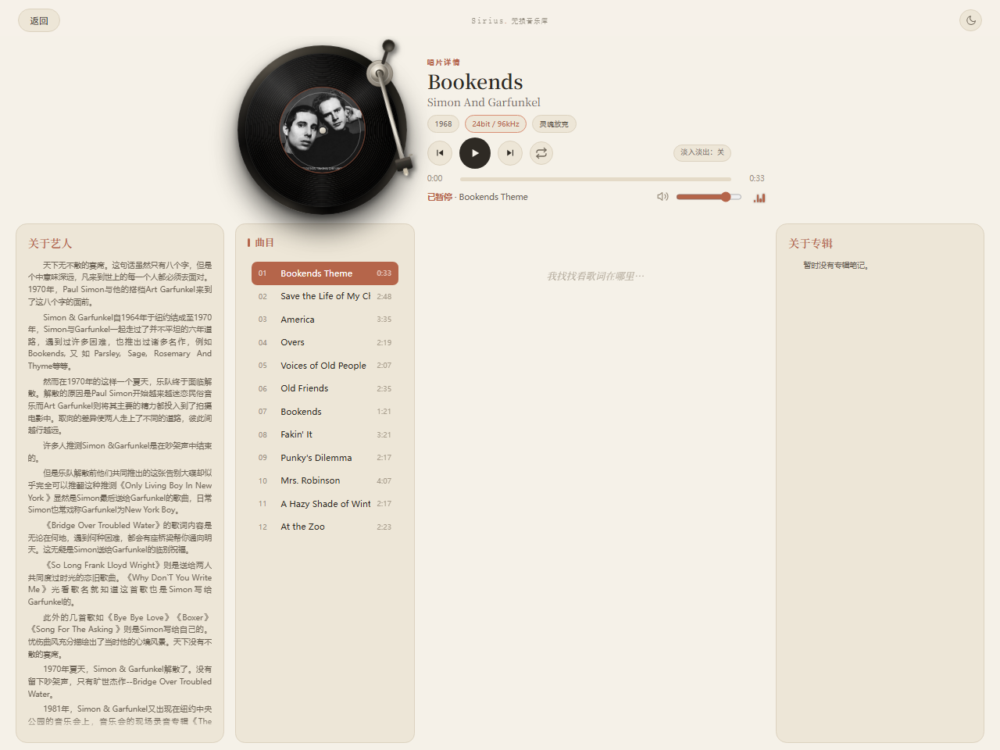

<div align="center"><br><br>

<br><br>

# Sirius · 無損音樂庫
<sub>Personal Lossless Music Library — Local · LAN · Temporary Tunnel</sub>
<br>
<sub>― 把每一張唱片，慢慢聽完整 ―</sub>
<br>

[](https://nodejs.org/)
[](https://www.python.org/)
[](#法)
[](#法)
[](#法)

<br>
<sub>[序](#序) · [覽](#覽) · [器](#器) · [法](#法) · [護](#護)</sub>
<br><br>

<br></div>

---

## 序 <a id="序"></a>

本專案是一套個人無損音樂庫播放器：**單文件前端頁面** 加 **一個 Node 靜態服務**，無構建、無依賴、無資料庫。

本地收藏的 FLAC 等無損唱片整理成封面牆，可按藝人、類型、年代、音質篩選與逐曲搜尋；點入專輯是以黑膠旋轉為視覺中心的播放頁，附曲目表、藝人與專輯筆記、歌詞與底部迷你播放條。同一套程式可在本機直聽、區域網路分享，亦可經臨時隧道對外開放聆聽。

播放鏈路不經資料庫：頁面樣式、腳本、圖標、字體全部內嵌，除歌詞站 `lrclib.net` 外不依賴任何 CDN 或外部服務。

---

## 覽 <a id="覽"></a>

**封面牆** —— 頂部為篩選與搜尋，主體是專輯封面牆；右側書籤式「換一批」更換一組推薦專輯，側欄為庫的足跡時間軸。


<sub>※ 首頁：全部 / 按藝人 / 按類型 / 按年代 / 按音質 篩選，搜尋藝人、專輯或曲目。</sub>

**播放頁** —— 黑膠與唱臂為視覺中心，曲目表居中，左右兩欄為藝人介紹與專輯筆記；離開唱片頁後，底部迷你條仍可繼續控制。



<sub>※ 播放頁：黑膠旋轉、順序 / 單曲循環 / 亂序、淡入淡出開關、歌詞區。</sub>

---

## 器 <a id="器"></a>

<sub>※ 公共倉庫僅含程式與文件；音訊、封面、歌詞與資料檔均被 `.gitignore` 排除，clone 下來只有程式。</sub>

| 編號 | 路徑 | 內容 | 進 Git |
|---|---|---|:---:|
| 〇一 | `音乐库.html` | 單文件播放器，樣式與腳本內嵌 | 是 |
| 〇二 | `music-server.js` | 本機靜態服務，8099 埠，支援 Range/206、gzip、ETag | 是 |
| 〇三 | `watchdog.js` | 每 30 秒探測服務，連續失敗 2 次後自動拉起 | 是 |
| 〇四 | `tunnel.js` | Cloudflare 臨時隧道守護進程，地址寫入本地檔案 | 是 |
| 〇五 | `start-all.js` | detached 子進程拉起服務與 watchdog 後退出 | 是 |
| 〇六 | `启动器/*.vbs` | Windows 雙擊啟動器：服務 / 隧道 / 全部 | 是 |
| 〇七 | `音乐库.py` | 維護工具統一入口 | 是 |
| 〇八 | `tools/*.py` | 導入、拆軌、校準、檢查、歌詞模組 | 是 |
| 〇九 | `库维护须知.md` | 資料規則、維護流程與故障記錄 | 是 |
| — | `data.js` | 專輯與曲目中繼資料 | 否 |
| — | `durations.js` | 曲目真實時長與播放偏移修正表 | 否 |
| — | `_covers/` | 專輯封面縮略圖 | 否 |
| — | `_lyrics/` | 按專輯下標命名的歌詞分片 | 否 |
| — | `无损/` | 無損音訊檔案及專輯目錄 | 否 |
| — | `_备份/` · `_logs/` · `_下载/` | 歷史備份、訪問與守護日誌、外部程式 | 否 |

---

## 法 <a id="法"></a>

### 前置依賴

| 依 | 所需 | 取之之法 |
|---|---|---|
| Node.js | 服務與頁面播放，≥ 18 | 官網安裝 LTS 版本 |
| Python 3 | 維護工具（可選，僅入庫 / 拆軌 / 校準時需要） | 官網安裝 |

### 啟動

```powershell
# Windows：雙擊 启动器\启动音乐库服务器.vbs
# 或在專案目錄命令行執行
node music-server.js
```

瀏覽器打開 `http://127.0.0.1:8099/` 即可。想連同隧道一起啟動，雙擊 `启动器\启动全部.vbs`。

亦可直接雙擊 `音乐库.html` 以 `file://` 打開聆聽；**入庫操作必須經本機服務**，純靜態打開只能聽。

### 維護命令

統一入口為 `python 音乐库.py <子命令>`：

```powershell
python 音乐库.py 导入    # 掃描目錄、查重並提交入庫
python 音乐库.py 拆轨    # 整軌音頻按 CUE / 軌距拆分逐曲
python 音乐库.py 校准    # 校準曲目時長與偏移，只動音訊頭部欄位
python 音乐库.py 检查    # 資料與檔案一致性自檢
python 音乐库.py 歌词    # 抓取並離線整理歌詞分片
```

<sub>※ 改資料前先讀 `库维护须知.md`，並先備份 `data.js`；維護操作只在本機執行。</sub>

### 資料結構

`data.js` 為 JavaScript 賦值，首行 `window.LIB_DATA=`，末尾以分號結束：

```text
{
  albums: [{
    artist, album, year, quality, disc, era, genre,
    cover, coverFile, intro, artistInfo, rel,
    tracks: [{ n, p }]
  }],
  updates: [{ date, title, text }],
  generated
}
```

所有欄位均為字串（`year` 無法確認時留空，頁面顯示「未標年」，不作猜測）。`rel` 是從專案根算起的專輯目錄（以 `无损/` 開頭），`tracks[].p` 是該目錄內的音訊檔名。

### 目錄命名規矩

專輯目錄統一採用 `(年份) 專輯名 [位深-採樣率] CD1`，例如 `(2001) 專輯名 [24-96] CD1`；解析不到年份就留空。

### 頁面依賴

**硬依賴只有兩個：`data.js` 與 `无损/`**，缺任何一個頁面都不成立；其餘皆為加分項，缺了只降級不罷工。

| 依賴 | 必需 | 缺了會怎樣 |
|---|:---:|---|
| `data.js` | 是 | 首頁空白，頂部提示資料缺失 |
| `无损/<rel>/<p>` | 是 | 封面牆仍在，但每一首都播不出來 |
| `durations.js` | 否 | 改用音訊頭裡的時長；頭部寫錯的曲目拖進度會跳到結尾 |
| `_covers/<coverFile>` | 否 | 退回專輯目錄內原圖；再沒有就顯示首字佔位塊 |
| `_lyrics/a<下標>.js` | 否 | 該專輯退回聯網搜尋 lrclib；搜不到則只顯示純曲目 |
| `/api/*` 介面 | 否 | 僅入庫流程使用；雙擊打開仍能聽，只是不能入庫 |

本機服務提供的介面：`/api/ping`、`/api/import/scan`、`POST /api/import/commit`、`POST /api/import/probe`、`POST /api/import/folder`、`POST /api/browse`。播放鏈路不經過它們。

---

## 護 <a id="護"></a>

<details>
<summary>克隆下來為何沒有專輯、封面與音樂？</summary>

<br>公共倉庫不包含私人資料。`无损/`、`_covers/`、`_lyrics/`、`data.js`、`durations.js`、`_备份/`、`_下载/`、`_logs/` 與隧道地址檔全部被 `.gitignore` 排除。需依照上文資料結構自行準備專輯中繼資料，並按 `rel` 與曲目檔名組織音訊目錄。
</details>

<details>
<summary>為什麼入庫只能在本機進行？</summary>

<br>服務只允許 loopback 請求寫盤；區域網路與隧道訪問僅用於聆聽，不開放遠端入庫、改資料或寫檔。
</details>

<details>
<summary>歌詞分片為何不允許在中間刪除或重排專輯？</summary>

<br>`_lyrics/a<專輯下標>.js` 按陣列下標命名。一旦在中間插入、刪除或重排，後續分片會全部指向錯誤的專輯，歌詞錯位。新專輯只能追加到 `albums` 陣列末尾；刪除專輯後須重編全部歌詞分片。
</details>

<details>
<summary>隧道網址為何每次重啟都變？</summary>

<br>使用的是 Cloudflare 臨時隧道，地址隨進程重啟更換；當前地址查看本機地址檔即可，勿將臨時地址寫入 README 或提交進倉庫。
</details>

<details>
<summary>整軌 WAV / 整張專輯如何入庫？</summary>

<br>整軌音頻須先拆成逐曲檔案，入庫按一個音訊檔對應一首曲目處理；可使用 `python 音乐库.py 拆轨`。
</details>

<details>
<summary>某些曲目為何播不出來？</summary>

<br>能否播放取決於瀏覽器支援的音訊格式，建議使用 Chrome / Edge；本地檔案缺失或損壞時，對應曲目自然無法播放，可先跑 `python 音乐库.py 检查` 核對檔案一致性。
</details>

<details>
<summary>`durations.js` 為何不建議手改？</summary>

<br>`LIB_DUR` 為曲目時長表，`LIB_OFF` 為播放偏移表，`LIB_BAD` 標記已知異常時長項，由 `校准` 子命令生成與維護；目錄變更須同步對應鍵，改前保留 `_备份/` 內的原值回滾點。
</details>

---

<div align="center">

<br>
<sub>紙承墨，墨載意，意馭器</sub>
<br><sub>西城閒人 · 識</sub>
<br><sub>本專案尚未附許可文件，使用與再發布以後續許可聲明為準 · © 2026 · LEE20260315</sub>
</div>
