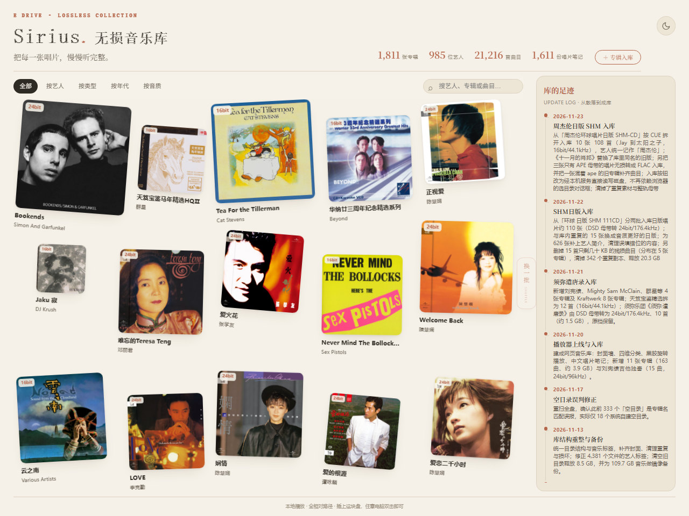

<div align="center"><br><br>

<br><br>

# Sirius · 無損音樂庫
<sub>Personal Lossless Music Library — Local · LAN · Temporary Tunnel</sub>
<br>
<sub>― 把每一張唱片，慢慢聽完整 ―</sub>
<br>

[](https://nodejs.org/)
[](https://www.python.org/)
[](#法)
[](#法)
[](#法)

<br>
<sub>[序](#序) · [覽](#覽) · [器](#器) · [法](#法) · [護](#護)</sub>
<br><br>

<br></div>

---

## 序 <a id="序"></a>

斯庫者，私家無損唱片之藏也。**一頁 HTML 為之器，一 Node 靜態服務為之樞**；無構建、無依賴、無資料庫。

所藏 FLAC 諸碟，列為封面之牆：可按藝人、類型、年代、音質而篩，可逐曲而索。點入一碟，則黑膠徐轉、唱臂輕落，曲目居中，藝人與專輯之筆記分列左右，歌詞隨曲而行；既出唱片之頁，底部迷你條猶可操之。

一器而三用：本機直聽，區域網路共賞，臨時隧道遠饋。樣式、腳本、圖標、字體，皆內嵌於一頁；除歌詞站 `lrclib.net` 外，不假 CDN，不倚外物。

---

## 覽 <a id="覽"></a>

**封面之牆** —— 上為篩選搜尋，中為專輯封面；右側「換一批」易一組推薦，側欄則庫之足跡時間軸也。



<sub>※ 首頁：全部 / 按藝人 / 按類型 / 按年代 / 按音質，兼可索藝人、專輯與曲目。</sub>

**唱片之頁** —— 黑膠唱臂為視覺之心，曲目居中，左右兩欄為藝人介紹與專輯筆記；去頁之後，迷你條仍可續控。


<sub>※ 播放頁：黑膠旋轉、順序 / 單曲循環 / 亂序、淡入淡出之關、歌詞之區。</sub>

---

## 器 <a id="器"></a>

<sub>※ 公倉所載，惟程式與文書；音訊、封面、歌詞、資料皆擯於 `.gitignore`，clone 所得，止於程式。</sub>

| 編號 | 路徑 | 內容 | 入 Git |
|---|---|---|:---:|
| 〇一 | `音乐库.html` | 單文件播放器，樣式腳本皆內嵌 | 是 |
| 〇二 | `music-server.js` | 本機靜態服務，8099 埠，Range/206、gzip、ETag 俱備 | 是 |
| 〇三 | `watchdog.js` | 每三十秒一探，連失二次則復起之 | 是 |
| 〇四 | `tunnel.js` | Cloudflare 臨時隧道之守護，址書於本地檔 | 是 |
| 〇五 | `start-all.js` | detached 子進程起服務與 watchdog，事畢自退 | 是 |
| 〇六 | `启动器/*.vbs` | Windows 雙擊之器：服務 / 隧道 / 全部 | 是 |
| 〇七 | `音乐库.py` | 維護諸令之總門 | 是 |
| 〇八 | `tools/*.py` | 導入、拆軌、校準、檢查、歌詞諸模組 | 是 |
| 〇九 | `库维护须知.md` | 資料之規、維護之法、故障之錄 | 是 |
| — | `data.js` | 專輯曲目之中繼資料 | 否 |
| — | `durations.js` | 曲目真實時長與偏移修正之表 | 否 |
| — | `_covers/` | 專輯封面縮圖 | 否 |
| — | `_lyrics/` | 依專輯下標命名之歌詞分片 | 否 |
| — | `无损/` | 無損音訊與專輯目錄 | 否 |
| — | `_备份/` · `_logs/` · `_下载/` | 舊備份、諸日誌、外部程式 | 否 |

---

## 法 <a id="法"></a>

### 前置依賴

| 依 | 所需 | 取之之法 |
|---|---|---|
| Node.js | 服務與播放，≥ 18 | 官網取 LTS 版 |
| Python 3 | 維護之器（可選，惟入庫 / 拆軌 / 校準時需之） | 官網取之 |

### 啟動

```powershell
# Windows：雙擊 启动器\启动音乐库服务器.vbs
# 或於專案目錄行之
node music-server.js
```

瀏覽器啟 `http://127.0.0.1:8099/` 可也。欲並隧道而起，雙擊 `启动器\启动全部.vbs`。

亦可雙擊 `音乐库.html`，以 `file://` 直啟而聽；**惟入庫必經本機服務**——徒啟靜頁，可聽而不可納。

### 維護諸令

總門惟一：`python 音乐库.py <子命令>`。

```powershell
python 音乐库.py 导入    # 掃描目錄、查重而納之
python 音乐库.py 拆轨    # 整軌之音，按 CUE 析為逐曲
python 音乐库.py 校准    # 正時長與偏移，惟動音訊頭部之欄
python 音乐库.py 检查    # 資料與檔案，核其一致
python 音乐库.py 歌词    # 採歌詞而離線整之
```

<sub>※ 凡改資料，先讀 `库维护须知.md`，先備 `data.js`；維護之事，止行於本機。</sub>

### 資料之構

`data.js` 者，JavaScript 賦值也：首行 `window.LIB_DATA=`，末以分號終。

```text
{
  albums: [{
    artist, album, year, quality, disc, era, genre,
    cover, coverFile, intro, artistInfo, rel,
    tracks: [{ n, p }]
  }],
  updates: [{ date, title, text }],
  generated
}
```

諸欄皆字串。`year` 無據則闕，頁示「未標年」，不妄猜也。`rel` 者，自專案根起之專輯目錄（以 `无损/` 為首）；`tracks[].p` 者，其目錄內之音訊檔名也。

### 目錄命名之規

專輯目錄，一律 `(年份) 專輯名 [位深-採樣率] CD1`，如 `(2001) 專輯名 [24-96] CD1`；年份不辨則闕，毋臆。

### 頁面所倚

**硬依賴惟二：`data.js` 與 `无损/`**——闕一則頁不立；其餘皆增益之物，闕之惟降級，不罷工也。

| 所倚 | 必需 | 闕之何如 |
|---|:---:|---|
| `data.js` | 是 | 首頁空白，頂示資料之失 |
| `无损/<rel>/<p>` | 是 | 封面之牆猶在，然曲曲不可播 |
| `durations.js` | 否 | 改信音訊頭中之時長；頭誤之曲，曳進度即墜末尾 |
| `_covers/<coverFile>` | 否 | 退取專輯目錄內原圖；復無，則示首字佔位之塊 |
| `_lyrics/a<下標>.js` | 否 | 是碟退而聯網索諸 lrclib；索之不得，惟示純曲目 |
| `/api/*` 諸介面 | 否 | 惟入庫用之；雙擊而啟者猶可聽，惟不可納 |

本機服務所供：`/api/ping`、`/api/import/scan`、`POST /api/import/commit`、`POST /api/import/probe`、`POST /api/import/folder`、`POST /api/browse`。播放之鏈，不經諸此。

---

## 護 <a id="護"></a>

<details>
<summary>克隆既畢，何以無碟無聲？</summary>

<br>公倉不藏私物。`无损/`、`_covers/`、`_lyrics/`、`data.js`、`durations.js`、`_备份/`、`_下载/`、`_logs/` 與隧道地址檔，皆為 `.gitignore` 所擯。欲自成一庫，依上文之構自備中繼資料，按 `rel` 與檔名安置音訊，而後啟服務可也。
</details>

<details>
<summary>入庫何以止於本機？</summary>

<br>服務惟許 loopback 之請寫盤；區域網路與隧道之客，止於聽，不與寫——遠端不可入庫、不可改資料、不可動檔案。非 GET 之請，其 `Content-Type` 必為 `application/json`，`Origin` 亦須屬本機或 `file://`；蓋跨站表單乃「簡單請求」，瀏覽器不先預檢而徑發，故非卡此不可。
</details>

<details>
<summary>源碼、日誌、備份，何以不可下？</summary>

<br>所供者，有定冊焉：`音乐库.html`、`data.js`、`durations.js` 三檔，與 `无损/`、`_covers/`、`_lyrics/` 三目，餘皆不予。請至，先按其名，復以真實路徑核之（Windows 之目錄聯接亦不能出此），不合者一例答以 404——非 403 也，403 猶告以有物在此。故隧道雖開，所洩止於聲與圖，不及代碼、日誌、備份。
</details>

<details>
<summary>歌詞分片，何以忌中刪中移？</summary>

<br>`_lyrics/a<專輯下標>.js` 以陣列下標為名。中插、中刪、重排，則其後諸片皆指錯碟，歌詞盡亂。故新碟惟可追加於 `albums` 之末；既刪一碟，須盡重編其片。
</details>

<details>
<summary>隧道之址，何以屢易？</summary>

<br>所用者，Cloudflare 臨時隧道也，址隨進程重啟而更。今址觀本機地址檔即可；慎勿書於 README，慎勿付諸倉庫。
</details>

<details>
<summary>整軌之碟，何以入庫？</summary>

<br>整軌須先析為逐曲——一檔一曲，而後納之。`python 音乐库.py 拆轨` 可任其事。
</details>

<details>
<summary>曲有不可播者，何也？</summary>

<br>一曰瀏覽器所支之格式有限，宜用 Chrome / Edge；二曰本地檔案闕失或損，其曲自不可播。可先行 `python 音乐库.py 检查`，以核資料與檔案之合。
</details>

<details>
<summary>`durations.js` 何以不宜手改？</summary>

<br>`LIB_DUR` 者，時長之表；`LIB_OFF` 者，偏移之表；`LIB_BAD` 者，已知異常之誌——皆 `校准` 所生所養。目錄既改，諸鍵須隨；改前留 `_备份/` 原值，以為回滾之地。
</details>

---

<div align="center">

<br>
<sub>紙承墨，墨載意，意馭器</sub>
<br><sub>西城閒人 · 識</sub>
<br><sub>印篆取崇羲篆體（王心怡、季旭昇），CC BY-ND 3.0 TW</sub>
<br><sub>本專案尚未附許可文件，使用與再發布以後續許可聲明為準 · © 2026 · LEE20260315</sub>
</div>

